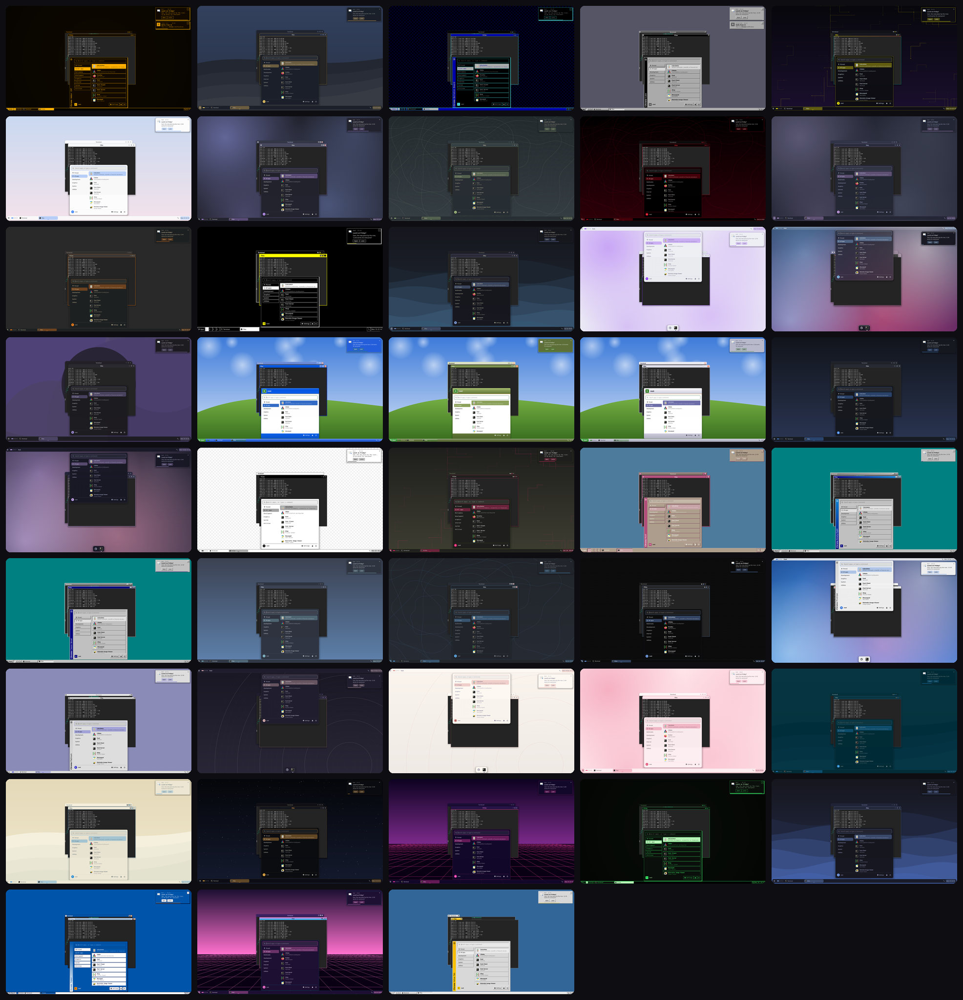

# Chrono

A Wayland desktop built from scratch, with themes from every era of computing — and a settings app
that lets you change everything without touching a config file.

- **Compositor** (`chrono`): C on wlroots 0.20. Server-side window frames drawn per theme, snapping
  (halves, quarters, maximize), workspaces, Alt+Tab switcher, built-in lock screen, idle lock and
  screen-off, night light, XWayland, screenshots, media/volume/brightness keys.
- **Shell** (`chrono-shell`): Qt 6 / QML on layer-shell. A bottom bar with the app menu, workspaces,
  pinned apps, running apps, status icons and clock; a dock for themes that want one; quick settings;
  calendar with notification history; notifications; volume/brightness OSD; power menu.
- **Settings** (`chrono-settings`): themes gallery, panel & dock, displays (drag to arrange,
  resolution, refresh rate, fractional scale, rotation, VRR, auto-revert), time & date, keyboard
  layouts, mouse & touchpad, windows & workspaces, shortcuts (with a key recorder), sound, power &
  lock, default apps & autostart, about.
- **29 themes**, each with its own generated wallpaper — see [Themes](#themes).

## Install

Arch Linux:

```sh
sudo pacman -S --needed base-devel cmake ninja wlroots0.20 wayland wayland-protocols libinput \
  libxkbcommon pixman cairo pango pam xcb-util-wm xorg-xwayland qt6-base qt6-declarative \
  qt6-wayland layer-shell-qt
# recommended extras
sudo pacman -S --needed foot grim slurp wl-clipboard brightnessctl playerctl libnotify \
  pipewire-pulse wireplumber networkmanager adwaita-icon-theme
git clone https://github.com/rxvy-dev/chrono && cd chrono
./install.sh
```

Other distros: install the same libraries (wlroots **0.20** is required) and run `./install.sh`.
It builds with CMake and installs to `/usr` so login managers find the session.

Then pick **Chrono** in your login manager, or run `chrono-session` from a TTY.

## Use

| Keys | Does |
| --- | --- |
| Super+Space / Super+D | App menu |
| Super+Return | Terminal (Interstellar if installed) |
| Super+E / Super+B | Files / browser |
| Super+Q, Alt+F4 | Close window |
| Super+←/→/↑/↓ | Snap left/right, maximize, minimize |
| Super+1…9, Super+Shift+1…9 | Go to / move window to workspace |
| Alt+Tab | Switch windows |
| Super+L | Lock |
| Super+I | Settings |
| Print, Super+Shift+S | Screenshot, area screenshot |

Everything is changeable in **Settings → Shortcuts**.

Right-click any app in the app menu or on the bar to **pin it to the bar**. Pinned apps stay on the bar;
running apps appear next to them.

## Configure by hand (optional)

`~/.config/chrono/chrono.conf` (INI). The settings app writes this file; `chronoctl reload` applies edits.

```ini
[general]
theme = ninety-five
terminal = interstellar
workspaces = 4

[panel]
position = bottom      ; bottom | top | theme
pinned = true
labels = true
dock = theme           ; theme | true | false

[clock]
format = 24h           ; auto | 12h | 24h
seconds = false
date = true

[appearance]
mode = theme           ; theme | light | dark
accent = theme         ; theme | #rrggbb | wallpaper
reduce_motion = false

[keybinds]
Super+Shift+Return = exec foot
Super+F1 = none        ; turn a built-in shortcut off
```

`chronoctl` talks to the running desktop: `chronoctl windows`, `chronoctl theme topaz`,
`chronoctl output DP-1 mode=2560x1440@144 scale=1.25`, `chronoctl subscribe`, …

## Themes



| Theme | Era | Style | Light/dark twin |
| --- | --- | --- | --- |
| Midnight *(default)* | modern | dark, rounded, floating bar | Daylight |
| Daylight | modern | bright and flat | Midnight |
| Liquid Glass | modern | translucent title bars, dock | |
| Mocha | modern | Catppuccin-style pastels, dark | Latte |
| Latte | modern | Catppuccin-style pastels, light | Mocha |
| Nord | modern | arctic blues | |
| Gruvbox | modern | warm retro-groove colours | |
| Tokyo Night | modern | indigo night, wave wallpaper | |
| Rosé Pine | modern | muted rose, ring wallpaper | Rosé Pine Dawn |
| Rosé Pine Dawn | modern | Rosé Pine's light variant | Rosé Pine |
| Dracula | modern | purple and pink, top bar | |
| Solarized Dark | modern | Solarized, dune wallpaper | Solarized Light |
| Solarized Light | modern | Solarized, light | Solarized Dark |
| Everforest | modern | soft greens, contour wallpaper | |
| Material You | modern | big shapes, accent taken from the wallpaper | |
| Synthwave | modern | neon sunset grid | |
| Cyberpunk | modern | acid yellow and cyan, circuit wallpaper | |
| Starfield | modern | deep space | |
| Mono | modern | black and white only | |
| Terminal | modern | flat, monospace, green on black, scanlines | |
| High Contrast | modern | black/white/yellow, thick focus borders | |
| Classic Bevel | retro | grey 3D bevels, navy title gradient | |
| Platinum | retro | grey ridged title bars | |
| Topaz | retro | 1-bit-era blue and white, pixel frames | |
| Yellow Tab | retro | yellow title tabs | |
| Motif | retro | chunky workstation bevels | |
| Cube | retro | black titles on grey | |
| Meadow | retro | glossy blue titles over green hills | |
| Pinstripe | retro | pinstripes and gel buttons | |

Per-theme screenshots (app menu open, two windows, a notification) are in
[`docs/screenshots/`](docs/screenshots/).

In **Settings → Themes** you get a live preview, a light/dark switch (for themes that have a twin),
an accent colour picker (any colour, or one taken from the wallpaper) and a *Reduce motion* switch.

## Make a theme

A theme is one text file; no code changes are needed. Put it in `~/.config/chrono/themes/` — Chrono
watches that folder, so saving the file restyles the desktop immediately and new files appear in
Settings straight away. Easiest start: copy one of the built-in themes from `/usr/share/chrono/themes/`.

```ini
[theme]
name = My Theme
era = modern              ; modern | retro (only used to group the gallery)
description = One line for the gallery.
variant = dark            ; dark | light (worked out from the colours if left out)
pair = my-theme-light     ; file name of its light/dark twin, for the light/dark switch

[colors]                  ; #rgb, #rrggbb or #rrggbbaa
bg = #1e1e2e              ; window and menu background
fg = #cdd6f4              ; text
accent = #89b4fa          ; or "wallpaper" to derive it from the wallpaper colours
accent_fg = #1e1e2e       ; text on the accent colour
selection = #89b4fa55
title_active = #313244    ; title bar (title_active2 for a gradient)
title_active_fg = #cdd6f4
title_inactive = #24243a
title_inactive_fg = #7f849c
border_active = #89b4fa
border_inactive = #45475a
button_bg = #45475a
button_fg = #cdd6f4
close_bg = #f38ba8
panel_bg = #181825ee      ; translucent panels are fine
panel_fg = #cdd6f4
panel_border = #89b4fa44
bevel_light = #ffffff     ; only used by bevelled styles
bevel_dark = #808080
bevel_shadow = #000000

[decor]
style = flat              ; flat bevel platinum pixel tab motif cube meadow pinstripe glass neon
title_height = 32
border_width = 1
corner_radius = 12
title_center = true
buttons = menu:minimize,maximize,close   ; left of the colon goes on the left
button_shape = circle     ; flat bevel circle gel square roundrect
button_size = 14
shadow = true
shadow_size = 22
shadow_alpha = 0.45

[fonts]                   ; Pango font lists: first installed one wins
ui = Inter, Noto Sans, DejaVu Sans 10
title = Inter, Noto Sans, DejaVu Sans Bold 10
mono = JetBrains Mono, DejaVu Sans Mono 10

[panel]
position = bottom         ; the user's Settings choice can override this
height = 40
style = floating          ; flat floating glass bevel pixel
launcher_label =          ; text on the app-menu button (empty = just the Chrono mark)
dock = false              ; true = separate dock at the bottom, bar moves to the top

[desktop]
wallpaper = pattern:waves ; solid | gradient | pattern:NAME | /path/to/image.png
color1 = #11111b
color2 = #313244

[cursor]
theme = Adwaita
size = 24

[icons]
theme = Adwaita
```

Wallpaper patterns (drawn in code, recoloured by `color1`, `color2` and the accent): `waves`,
`topo`, `blobs`, `material`, `rings`, `dunes`, `circuit`, `scanlines`, `stars`, `grid`, `aurora`,
`hills`, `checker`, `pinstripe`, `dots`, `platinum`, `weave`.

Check your colours with `python3 tests/contrast.py` (WCAG: 4.5:1 for text, 3:1 for inactive titles),
and render a preview with `chrono-theme-preview my-theme out.png`.

## Development

```sh
cmake -B build -G Ninja && ninja -C build
WLR_BACKENDS=headless WLR_RENDERER=pixman ./build/chrono   # or run nested inside another compositor
```

CI builds on Arch with wlroots 0.20, runs the compositor and shell headless, and pushes logs and
screenshots of every theme to the `ci-results` branch.
